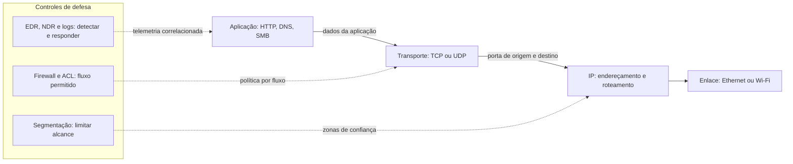

# Redes, Portas e Protocolos — Guia de Segurança Defensiva

Referência prática para entender a exposição de serviços de rede, priorizar riscos e aplicar controles de Blue Team. Os comandos são voltados à inspeção de sistemas próprios ou explicitamente autorizados. Este guia não substitui inventário, gestão de vulnerabilidades nem análise contextual.

MITRE significa MITRE Corporation; ATT&CK é a base de táticas e técnicas adversárias mantida pela MITRE. SOC (Security Operations Center) é o Centro de Operações de Segurança.

## Navegação rápida

| Pergunta | Onde ir |
|---|---|
| Qual a diferença entre porta e protocolo? | [Portas vs. protocolos](docs/fundamentos/portas-vs-protocolos.md) |
| Quais portas exigem atenção prioritária? | [Portas críticas](docs/mapa-de-portas/portas-criticas.md) |
| Como reduzir a exposição de SMB/445? | [Portas críticas](docs/mapa-de-portas/portas-criticas.md) e [SMB](docs/protocolos/smb.md) |
| Que ataques e CVEs recentes acompanhar? | [Panorama 2025–2026](docs/ataques-recentes/panorama-2025-2026.md) |
| Como segmentar a rede? | [Segmentação e firewall](docs/seguranca-e-defesa/segmentacao-e-firewall.md) |
| Onde estão os padrões e catálogos oficiais? | [Links oficiais](data/links-oficiais.md) |

## Comunicação e pontos de controle

Uma porta identifica um endpoint de transporte; não prova qual serviço está ativo nem se ele está vulnerável. Veja [fundamentos](docs/fundamentos/portas-vs-protocolos.md), [glossário](docs/glossario.md) e [mapa de portas](docs/mapa-de-portas/portas-criticas.md).

## Quick Start

1. Consulte o [glossário](docs/glossario.md) para siglas e conceitos.
2. Leia [portas vs. protocolos](docs/fundamentos/portas-vs-protocolos.md).
3. Use o [mapa de portas críticas](docs/mapa-de-portas/portas-criticas.md) para priorizar controles.

## Aviso de uso

Execute verificações apenas em ativos próprios ou com autorização documentada. Não use resultados de uma porta isolada para concluir que um sistema está comprometido: confirme serviço, versão, exposição, configuração e evidências nos logs. Os dados de incidentes devem ser conferidos nas fontes vinculadas; alegações sem referência rastreável são identificadas como não confirmadas.
