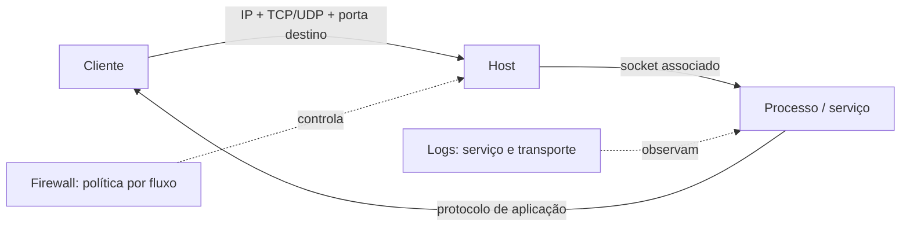

# Portas vs. protocolos: a distinção crucial

## Analogia

A **porta** é o número da suíte em um prédio: ajuda a encaminhar a conversa ao serviço correto. O **protocolo** é o idioma e o conjunto de regras usados dentro da suíte. O endereço IP localiza o prédio; o transporte e a porta localizam um endpoint de comunicação.

## Definição técnica

Uma porta TCP (Transmission Control Protocol) ou UDP (User Datagram Protocol) é um identificador lógico de 16 bits, no intervalo 0–65.535, usado no cabeçalho de transporte para multiplexar comunicações entre aplicações. Em cada conexão há portas de origem e destino. O sistema operacional associa sockets a processos e estados de rede. Isso não significa que toda porta seja um serviço escutando, nem que uma porta identifique de forma infalível o protocolo de aplicação.

Um **protocolo** especifica formatos, semântica e regras para trocar mensagens. HTTP (Hypertext Transfer Protocol), DNS (Domain Name System) e SMB (Server Message Block) são protocolos de aplicação; TCP e UDP transportam dados. TLS (Transport Layer Security) pode proteger protocolos de aplicação. A mesma aplicação pode usar portas diferentes, e uma porta pode carregar serviços não convencionais.

## Exemplo: 443

TCP/443 é convencionalmente associado a HTTPS (HTTP Secure), isto é, HTTP protegido por TLS. A porta é um ponto de encaminhamento; TLS negocia propriedades criptográficas e HTTP define requisições e respostas. UDP/443 também é usado por QUIC (Quick UDP Internet Connections), que transporta HTTP/3. Portanto, “443 aberto” não prova que o serviço seja HTTPS nem que esteja seguro.

## Por que importa para segurança

Uma porta aberta não é, isoladamente, uma vulnerabilidade. O risco depende do serviço real, versão e configuração, identidade/autenticação, dados acessíveis, exposição à rede e controles ao redor. Uma porta fechada na borda também pode estar disponível dentro de uma rede plana.

**Ação prática:** confirme o processo local que escuta, o protocolo e a versão; depois verifique quem consegue alcançá-lo e se esse acesso é necessário. Referências: [IANA](https://www.iana.org/assignments/service-names-port-numbers/) e [RFC 6335](https://www.rfc-editor.org/rfc/rfc6335).
