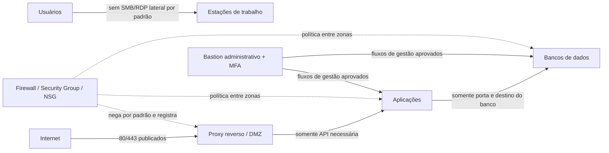

# Segmentação e firewall

O princípio **default-deny** bloqueia por padrão e libera apenas fluxos necessários, com proprietário, justificativa, prazo/revisão e origem/destino definidos. ACL (Access Control List, lista de controle de acesso) e firewall aplicam políticas a esses fluxos. Uma porta permitida deve corresponder a uma necessidade de negócio e a um serviço inventariado.

## Modelo de zonas

Use VLANs (Virtual Local Area Networks, redes locais virtuais)/sub-redes para separar funções, mas aplique controles de camada 3/4 entre zonas: VLAN isolada sem política de roteamento não garante contenção. DMZ (zona desmilitarizada) é uma zona de serviços expostos controlados. Em nuvem, Security Groups/Network Security Groups (NSG, grupos de segurança de rede) filtram fluxos segundo recursos do provedor; confira regras efetivas, herança e exposição IPv6.

## Revisão de regra

Registre protocolo, porta, origem, destino, sentido, dono do serviço, motivo, data de aprovação e expiração/revisão. Evite `any/any`, acesso administrativo direto e regras permanentes temporárias. Revise logs de negação e fluxos aceitos para identificar dependências reais, sem converter automaticamente todo tráfego observado em permissão.

**Ação prática:** desenhe fluxos esperados, bloqueie tráfego lateral não necessário e teste que usuários não alcançam portas administrativas/bancos. Links: [NIST SP 800-41 Rev. 1](https://csrc.nist.gov/pubs/sp/800/41/r1/final) e [CISA Zero Trust Maturity Model](https://www.cisa.gov/resources-tools/resources/zero-trust-maturity-model).
